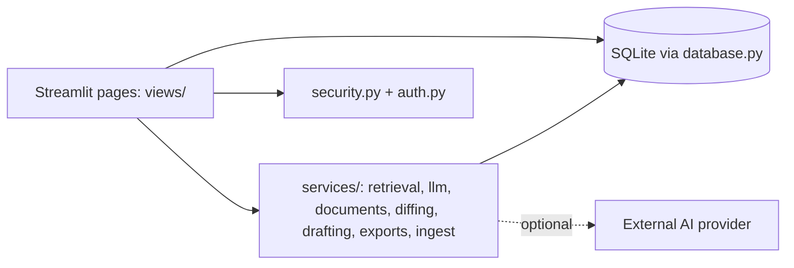
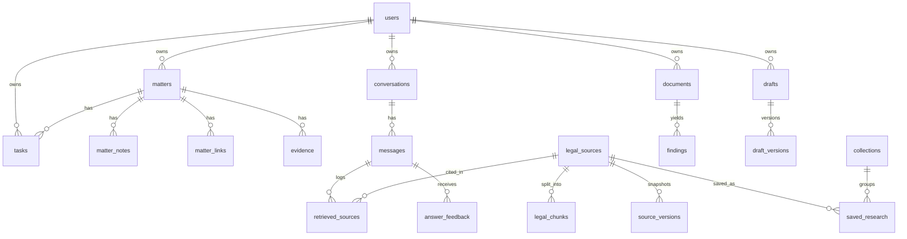

# Legal S India

AI-assisted Indian legal information, document intelligence and case management. Pure Python, deployed with Streamlit.
**Not a law firm, not a government portal, not legal advice.** Built as a Computer Engineering diploma (ITR) project.

## Run locally
```
pip install -r requirements.txt
cp .streamlit/secrets.toml.example .streamlit/secrets.toml     # set ADMIN_EMAIL / ADMIN_PASSWORD
python seed.py                                                  # optional demo user + [DEMO] data
streamlit run app.py
```
Demo login (after seed): `demo@example.com` / `demo-password-1`. The admin account is created from your secrets on first start.

## Deploy on Streamlit Community Cloud
1. Push this folder to GitHub (`storage/` and `secrets.toml` are git-ignored). 2. New app → select `app.py`.
3. Paste the contents of `secrets.toml.example` (with real values) into *Settings → Secrets*.
4. **Important:** Community Cloud's disk is not permanent, so the SQLite file and uploads can reset on restart.
   Fine for a live demo; for lasting data you would move `database.py` to a hosted Postgres.

## Feature map (all implemented)
| Page | What works |
|---|---|
| Legal AI Assistant | multi-turn saved chats, search, domain filters, RAG with validated citations, insufficient-evidence reply, follow-ups, feedback, export, save to matter, language option* |
| Legal Research | keyword / vector / combined search, section lookup, filters, save, collections, saved searches, citation export, provision compare, version history |
| Knowledge Graph | Domain→Act→Provision from metadata; inferred links drawn dashed and labelled |
| Document Analyzer | PDF/DOCX upload, validation, extraction, entities, clause findings with page + passage, review status, checklist by doc type, reports, delete |
| Comparison Lab | paragraph + word diff (difflib), modified/added/removed, date/amount/party differences, history, export |
| Drafting Studio | 8 templates, validation, review, editing, versions, compare, restore, DOCX/PDF/TXT export, link to matter |
| My Cases / Evidence / Dates | matters, notes, tasks, links, timeline, report; evidence index with SHA-256; month/week calendar, in-app reminders, .ics export |
| Help Preparation | questionnaire → facts vs organised summary, checklist, questions for advocate |
| Privacy centre | delete data, JSON export, redaction, audit history, AI-processing disclosure |
| Global Search, Analytics | per-user search; stored-data metrics kept separate from retrieval evaluation |
| Administration | users/roles, sources (edit, verify, import CSV, versions), jobs, errors, feedback, security events, health. No private content screens |

\*Hindi/Marathi answers need an external AI provider (set `ANTHROPIC_API_KEY` and `LLM_MODEL`); otherwise English extractive mode runs and says so.

## Architecture

Retrieval pipeline: ingest → chunk (word window + overlap) → index (BM25 + TF-IDF vectors) → query (stemming, small synonym expansion, section lookup, filters) → rank (BM25, cosine, Reciprocal Rank Fusion) → evidence check → answer provider → **citation validation** → store retrieval log.

## ER diagram

Ownership: every user-owned table has `user_id`; id lookups go through `database.owned()`; foreign keys use `ON DELETE CASCADE` so deleting a document/matter/conversation removes dependants.

## "API" documentation
Streamlit has no HTTP layer, so the service functions are the contract:
`auth.register/login`, `security.validate_upload/store_file`, `retrieval.Index.search/is_sufficient/evaluate`, `llm.build_answer/validate_citations`, `documents.extract_text/analyze`, `diffing.compare`, `drafting.validate/render`, `exports.make_docx/make_pdf/make_ics/redact`, `ingest.import_csv`.

## Testing
```
python -m unittest discover -s tests -v     # 24 backend tests
python tests/smoke_ui.py                    # renders every page with a stubbed Streamlit + real DB flows
```
Covered: password hashing, lockout, no admin via registration, cross-user access, cascade delete, persistence, invalid uploads, path traversal, citation validation (fake citations removed), insufficient evidence, filters, metrics, chunk overlap, CSV import errors, version snapshots, DOCX/PDF round-trip, diff, placeholders, ICS.
**Not covered:** real browser interaction (buttons, layout). Click through each page once before your demo.

## Honest limitations
- **Legal data:** `data/legal_sources.csv` holds 23 paraphrased summaries written by the project author, all marked `unverified`. They are a demo set, not authoritative text. Before presenting, compare each with India Code and mark it `verified` in Administration. Several entries (labour laws, IPC→BNS) carry notes that the law has been reorganised, so check current status.
- **"Vector" search is lexical TF-IDF**, not neural embeddings. It is explainable but cannot match meaning without shared words. Swapping in sentence-transformers is a contained change in `retrieval.py`.
- **Evaluation:** 12 questions, 23 sources, written by the same author who wrote the synonym list. Results look good (MRR ≈ 0.96) *because the test is small and easy*; do not quote them as accuracy.
- **Document analysis is rule-based** (regex keywords), so it can miss or misread clauses. No OCR. No model has been trained.
- Without an AI key the assistant is extractive: it shows retrieved text and templated guidance; it does not write new explanations.
- No email/push notifications; reminders are in-app. No statutory deadline calculation.
- Sign-in lasts for the browser session (no refresh tokens). Login lockout is per email. Not security-audited.
- Evidence files are fingerprinted (SHA-256), not stored. A hash does not prove authenticity or admissibility.
